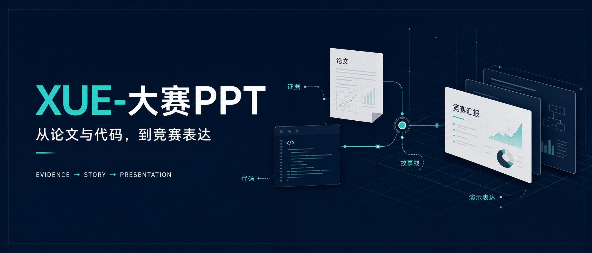
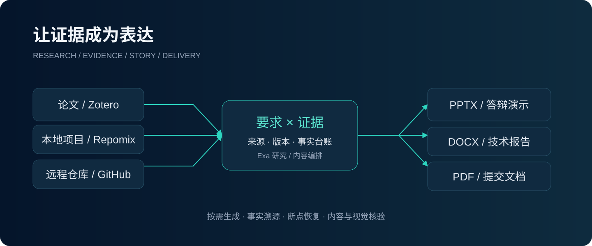
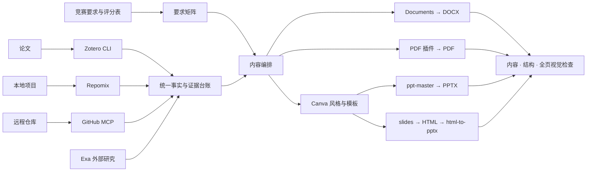

<p align="center">
  
</p>

<h1 align="center">XUE-大赛PPT</h1>
<p align="center"><b>把竞赛要求、论文和项目，组织成有出处、可核验、可继续的参赛材料。</b></p>
<p align="center">
  <a href="LICENSE"></a>
  
  
  
</p>

<p align="center"><a href="#快速开始">快速开始</a> · <a href="#工作链路">工作链路</a> · <a href="#依赖与工具">依赖与工具</a> · <a href="#开发与验证">开发与验证</a></p>

## 它能帮你做什么

你提供竞赛章程、评分表和论文或项目；插件在 Codex 中协调研究、证据整理、写作、演示制作与检查。

- **按需交付**：技术报告、创新创业计划书、混合材料与答辩 PPT。要求不明确时，先确认需要哪些文件。
- **材料各走其路**：论文先入 Zotero，本地项目用 Repomix，远程代码用 GitHub MCP；混合输入共享事实台账。
- **证据贯穿全文**：记录来源、版本、页码与待补数据。实现、实测、计划分开表达，不编造成绩和经历。
- **失败继续处理**：尝试可用替代路线，仍失败就记录并跳过，完成其余步骤后统一报告影响。
- **支持断点恢复**：保存输入输出哈希和依赖关系，变更后重做受影响部分，相关质量检查同步失效。

这是一个 **Codex 编排插件**，需要已连接的服务与对应技能。`workflow.py` 管理状态，实际文档由 Codex 调用工具生成。

## 快速开始

### 1. 安装轻量版

仓库已经包含可安装的轻量版 marketplace。先确认当前 Codex CLI 支持 `codex plugin --help`，再执行：

```bash
codex plugin marketplace add lixuelongbinhe-afk/XUE--PPT
codex plugin add xue-contest-ppt-lite@xue-competition-tools-lite
```

也可克隆到固定目录后添加本地 marketplace：

```bash
git clone https://github.com/lixuelongbinhe-afk/XUE--PPT.git
codex plugin marketplace add ./XUE--PPT
codex plugin add xue-contest-ppt-lite@xue-competition-tools-lite
```

刷新客户端或开启新聊天，确认 **XUE-大赛PPT** 已启用。桌面客户端入口可能随版本变化，以本机 CLI 帮助和插件界面为准。

> GitHub 仓库地址使用 `XUE--PPT`；插件界面名称保留 **XUE-大赛PPT**。机器标识使用兼容的 ASCII 名称。

### 2. 准备本次任务的依赖

按下方依赖表连接所需工具。服务登录、Zotero 文献库、模型和渲染器由你自己的环境提供；本仓库不携带账户凭据，也不自动安装全部依赖。

### 3. 交给 Codex

```text
使用 $competition-docs。
根据这份竞赛要求、我的论文和项目，生成技术报告 DOCX/PDF，
再制作 8 分钟答辩 PPTX。论文先导入 Zotero；
项目默认只读，若需运行测试或构建，请先说明并问我。
```

也可以只做一份 PPT：

```text
使用 $competition-docs。按评分表，把这个 GitHub 项目整理成答辩 PPTX。
保留技术证据和引用，缺少实测结果的地方标为待补充。
```

继续已有任务时，提供原任务目录并说“继续”，插件会先检查状态和材料变化。

## 工作链路



*封面通过 Infinite Canvas 生成；此流程图为可编辑 SVG，具体工具路由如下。*



1. **读要求**：提取强制格式、篇幅、匿名规则、引用和交付物，建立要求矩阵。
2. **读材料**：固定来源和代码版本，补充外部研究；必要的关键缺口一次问一个问题。
3. **编排生成**：沿用已确认方向；PPT 先参考 Canva，再选择生成路线。
4. **检查交付**：核对要求覆盖与跨文件一致性，打开实际渲染页检查，记录未验证项。

**Canva** 用于运行时 PPT 风格/模板发现；**Infinite Canvas** 用于本仓库 README 配图，二者职责不同。

## 依赖与工具

| 依赖 | 什么时候用 | 提供方式 |
|---|---|---|
| Zotero CLI + zotero-cli 技能 | 论文导入、全文与引用 | 外部安装，连接自己的文献库 |
| Repomix + repomix-explorer | 本地代码整理 | 外部 CLI/技能 |
| GitHub 官方 MCP | 远程仓库读取 | 外部服务连接 |
| Exa + exa-web-search | 文献、政策、市场和竞品研究 | 默认研究依赖；整合版提供技能/配置 |
| Canva 插件 | PPT 风格参考与可导出模板 | 外部服务连接，按实际可用能力执行 |
| ppt-master | 原生可编辑 PPTX | 轻量版外置；整合版内置获许可内容 |
| slides + html-to-pptx | HTML 演示与 PPTX 转换 | 轻量版外置；整合版内置获许可内容 |
| Documents / PDF 插件 | DOCX、PDF 读取、生成与渲染 | 外部插件 |
| grill-me / write-a-skill | 需求追问与技能维护 | 外部技能；总控含必要独立规则 |

具体清单见 [dependencies.json](plugins/xue-contest-ppt-lite/dependencies.json)。该清单是说明文件，**不是自动依赖安装器**。

## 两种分发方式

| | 轻量版 | 整合版 |
|---|---|---|
| 总控流程、恢复脚本、要求与质量规则 | ✓ | ✓ |
| ppt-master / slides / html-to-pptx | 使用已有安装 | 内置许可允许的上游文件 |
| Exa | 使用已有连接 | 附技能与 MCP 配置 |
| Documents / PDF / Canva / GitHub | 外部连接 | 外部连接 |
| 适合 | 已配置常用技能的 Codex | 希望统一打包演示工具的环境 |

二选一启用，避免重复技能；已有 Exa 连接时避免重复注册。整合版需要从获许可的上游源码构建，不把第三方服务和本地运行时打入仓库。

## 开发与验证

需要 Python 3。状态脚本测试使用标准库，测试不连接真实账户，也不执行用户项目。

```bash
python3 -m unittest discover -s tests -v
python3 tools/build.py --variant lite --out dist
```

生成目录位于 `work/`，ZIP 位于 `--out` 指定目录。修改总控请编辑 `plugins/competition-docs-core/`，重新构建后同步仓库的轻量分发目录，避免直接修改生成文件。

### 构建整合版

构建器默认查找本机已有技能；也可显式指定源码目录。各目录必须保留原始 LICENSE 和 NOTICE。Exa 指向含 `.mcp.json`、LICENSE 和 `skills/` 的插件根目录。

```bash
export XUE_VENDOR_PPT_MASTER=/path/to/ppt-master
export XUE_VENDOR_SLIDES=/path/to/slides
export XUE_VENDOR_HTML_TO_PPTX=/path/to/html-to-editable-pptx
export XUE_VENDOR_EXA_WEB_SEARCH=/path/to/exa-plugin
python3 tools/build.py --variant all --out dist
python3 tools/validate.py
```

构建器保留第三方许可，运行 ppt-master 上游完整性检查，并生成文件哈希清单。`tools/validate.py` 检查两种已构建分发包，因此先完成两版构建再运行。

### 当前验证范围

- 已通过：10 项状态与恢复回归测试、轻量版构建、两版已有构建的结构与哈希检查。
- 已在本地完成：技能格式与隔离安装检查。
- **尚未验证**：真实参赛材料下的 Zotero 导入、Canva 模板获取、全部文档生成与全页渲染的端到端流程。

脚本通过不能代替实际成品检查；缺少强制项或渲染证据时，输出只能称草稿或部分完成。验收用例见 [scenarios.md](plugins/competition-docs-core/skills/competition-docs/references/scenarios.md)。

## 使用边界

项目代码默认只读。运行项目测试、构建或服务前先说明命令与写入范围并取得授权。论文导入限本次材料并去重；未公开源码、密钥与个人信息不发送到外部研究或设计服务。

插件不会自动提交比赛、部署项目或购买模板。工具不可用会记录替代路线、跳过项和最终影响，不把未生成或未验证的文件描述为完成。

## 许可证与致谢

本项目原创编排代码与文档使用 [MIT License](LICENSE)。第三方文件按各自许可证分发，不代表上游或服务方为本项目背书。

感谢 PPT Master、Slides、HTML to PPTX、Exa 及相关技能作者。具体归属、许可和服务边界以分发包的 [THIRD_PARTY_NOTICES.md](plugins/xue-contest-ppt-lite/THIRD_PARTY_NOTICES.md) 与上游 LICENSE/NOTICE 为准。

README 封面通过 Infinite Canvas 生成；流程图为手工编写的可编辑 SVG。图片文件随仓库保存，不依赖临时云端链接。
